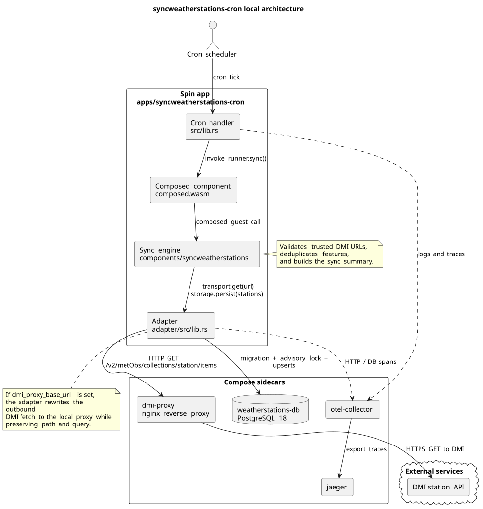

# syncweatherstations-cron design

## Purpose

`apps/syncweatherstations-cron` is a Spin cron application that synchronizes the
DMI weather-station catalog into PostgreSQL. The app reuses the existing
`components/syncweatherstations` WebAssembly component for the actual sync
logic and adds the host-specific pieces needed to run that component inside
Spin.

The production-shaped schedule is once per week at 03:00 on Sunday from
`spin.toml`. The Docker Compose deployment uses `spin.compose.toml` with a
30-second cron interval so the full flow can be observed locally without
waiting for the weekly run.

## Main components

### 1. `components/syncweatherstations`

This is the core sync engine. It owns:

- fetching paginated station data from DMI
- validating that only trusted DMI URLs are followed
- validating the decoded payload
- de-duplicating stations by `feature_id`
- sorting the final station list
- reporting a sync summary with page and row counts

The component does **not** know how HTTP or PostgreSQL are implemented. It
imports abstract `transport` and `storage` interfaces and exports an async
`runner.sync()` operation.

### 2. `apps/syncweatherstations-cron/adapter`

The adapter is the Spin-specific host bridge. It implements the imported
`transport` and `storage` interfaces for the sync component:

- `transport.get` uses Spin outbound HTTP
- `transport.sleep-ms` handles retry delays
- `storage.persist` opens the PostgreSQL connection with Spin outbound
  Postgres, runs the migration, takes the advisory lock, and performs the
  upsert loop

The adapter also contains the **compose-only proxy workaround**. When the
Spin variable `dmi_proxy_base_url` is set, it rewrites the outbound DMI fetch
to that proxy URL while preserving the original path and query string. This
keeps the sync component's DMI URL validation unchanged.

### 3. `apps/syncweatherstations-cron`

This is the cron handler component created from the Spin cron template. It is
the entrypoint that the cron trigger invokes. On each cron tick it calls the
composed `runner.sync()` export and logs the resulting summary.

### 4. Composition output: `composed.wasm`

`build.sh` builds:

1. the cron handler
2. the adapter
3. the reusable sync component

It then composes them with `wac` into `composed.wasm`, which is the single
component referenced by the Spin manifest.

## Runtime flow

1. Spin's cron trigger fires.
2. The cron handler calls `runner.sync()`.
3. The sync component requests pages from DMI through the imported
   `transport.get` API.
4. The adapter sends the HTTP request either:
   - directly to DMI, or
   - to the local `dmi-proxy` sidecar when `dmi_proxy_base_url` is configured.
5. The sync component validates, de-duplicates, and normalizes the station
   payload.
6. The sync component passes the final station list to `storage.persist`.
7. The adapter opens PostgreSQL, applies the migration if needed, acquires an
   advisory transaction lock, and upserts the station rows.
8. The cron handler logs the summary.

## Why the sidecar exists

During local Docker deployment, direct outbound HTTPS from Spin to
`https://opendataapi.dmi.dk` reproducibly stalled inside
`spin_sdk::http::send(request).await`, even though:

- cron scheduling worked
- Docker networking worked
- PostgreSQL access worked
- the same DMI URL was reachable from the host and from a normal container on
  the same Docker network

To keep local deployment working, Compose adds a small nginx sidecar:

- `dmi-proxy` receives plain HTTP from the Spin app on the internal Docker
  network
- `dmi-proxy` forwards that request to DMI over HTTPS
- the adapter rewrites only the transport destination, not the validated DMI
  URLs used by the sync component

This makes the workaround local and operationally isolated.

## Docker Compose deployment

The local stack consists of:

- `weatherstations-db`: PostgreSQL 18 with a named volume
- `dmi-proxy`: nginx reverse proxy for the DMI station endpoint
- `syncweatherstations-cron`: Spin 4.2.3 with the cron trigger plugin
- `otel-collector`: OTLP receiver and debug exporter
- `jaeger`: local trace UI

Key runtime variables passed into the Spin container:

- `SPIN_VARIABLE_DB_URL`
- `SPIN_VARIABLE_DB_OUTBOUND_HOST`
- `SPIN_VARIABLE_DMI_PROXY_BASE_URL`
- OTLP environment variables for OpenTelemetry export

## Observability

The Compose deployment enables Spin's experimental WASI OpenTelemetry support.
Traces are sent to the local OpenTelemetry Collector and can be inspected in
Jaeger. In practice this is useful for separating:

- cron-trigger problems
- outbound HTTP problems
- outbound PostgreSQL problems
- sync-component data validation failures

## Data and consistency model

Persistence is intentionally idempotent:

- the migration is applied before writes
- an advisory transaction lock serializes overlapping runs
- rows are upserted by `feature_id`
- unchanged rows are not rewritten unless the source JSON differs

This allows the short local cron cadence to be used safely during
investigation and verification.

## Current validated local behavior

The Compose deployment has been verified locally with the sidecar in place:

- cron fires every 30 seconds
- the sync fetches three DMI pages
- PostgreSQL contains the `station_versions` table
- the local database contains 1544 synchronized station rows

That validation confirms the overall design, the composition approach, the
storage path, and the sidecar workaround.
