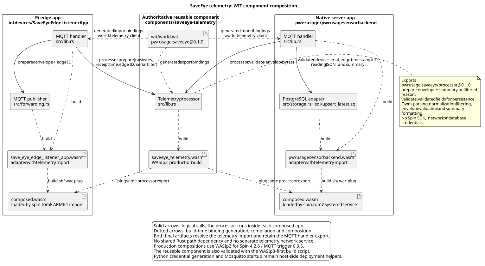

# SaveEye telemetry component

Reusable WIT-based WebAssembly component, composed into
[`SaveEyeEdgeListenerApp`](../../iotdevices/SaveEyeEdgeListenerApp/README.md)
and [`pwrusagesensorbackend`](../../pwerusage/pwrusagesensorbackend/README.md)
with `wac plug`. It replaces the former shared Rust library under `pwerusage`.
Neither app links the model as a Rust path dependency.



[UML source](../../iotdevices/saveeye-components.puml) |
[Pi/server deployment diagram](../../iotdevices/saveeye-deployment.svg)

## Interface

[`wit/world.wit`](wit/world.wit) is the source of truth for
`pwrusage:saveeye/processor@0.1.0`. Bindings are generated, never edited.

| Operation | Input | Output |
| --- | --- | --- |
| `prepare` | Raw MQTT bytes, edge receipt timestamp, edge ID, optional serial filter | Version-1 envelope bytes and log summary, or a filtered-device reason |
| `validate` | Forwarded MQTT envelope bytes | Validated device serial, edge timestamp/ID, normalized reading JSON and summary |

Errors distinguish invalid raw telemetry, invalid envelopes and invalid
configuration. The apps log/acknowledge bad input; configuration, MQTT and
database failures remain explicit. Serial filtering is trimmed and
case-insensitive. Missing device serials keep the original `"unknown"`
fallback. Missing measurements stay missing; derived watts/kWh, timestamps and
envelope validation are unchanged. Lossless JSON float parsing preserves
fractional measurements across the component/transport boundary.

The component owns parsing, filtering, normalization, envelope validation and
summary formatting. It has no Spin dependency or network/database credentials.
Apps supply timestamps/configuration and own MQTT and PostgreSQL operations.
The Python credential generator and Mosquitto configuration/startup helpers
are host-side deployment tools under `pwerusage/deploy`, not Wasm logic.

## Build and test

From this directory:

```bash
cargo test --locked
cargo clippy --locked --all-targets -- -D warnings
cargo fmt --check
../../.github/skills/wasi-component-build/scripts/build.sh --release --locked
```

The shared build script tries WASIp3 first, then falls back to WASIp2.
Inspect the path printed in its `RESULT` line with
`wasm-tools component wit <component-path>`.

For production Spin 4.2.6 / MQTT trigger 0.9.6 compatibility, each consuming
app's `spin build` builds this component and its own adapter for WASIp2, then
uses `wac-cli` 0.10.1 to produce the final `composed.wasm`. Both consume the
`telemetry-client` world from the same WIT file. The final artifact has no
unresolved telemetry import and retains the MQTT handler export.

The component has native-testable normalization and exported-operation tests.
The backend integration suite additionally executes the real composition
through two brokers and PostgreSQL, including an ARM64 edge image.
